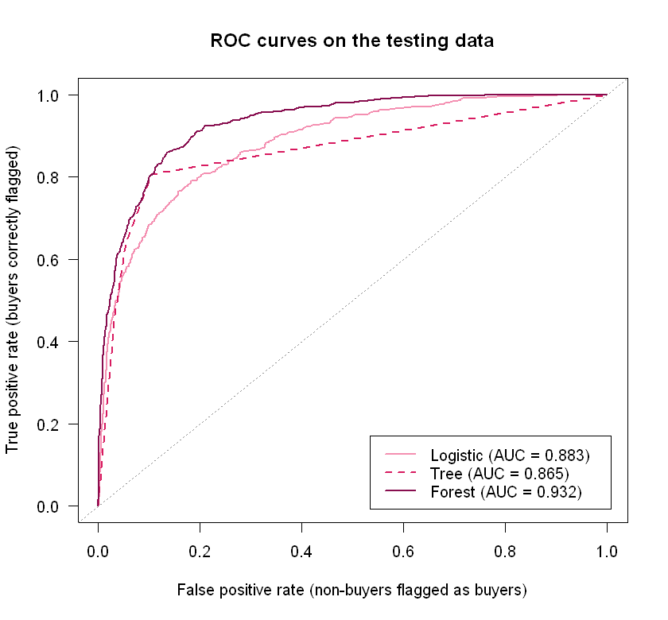
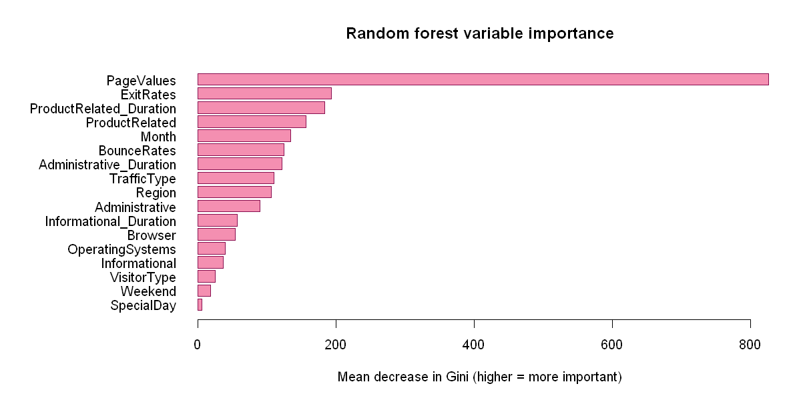

# Predicting Online Purchases from Website Session Data

**Can website behavior predict whether a visit to an online store ends in a purchase?**

Using 12,330 real browsing sessions from an e-commerce site, I trained and compared logistic regression, a decision tree and a random forest. The best model, a random forest, ranks buyers above non-buyers with an **AUC of 0.932** on held-out data, and a simplified version using only **6 of 17 predictors** keeps almost all of that performance (AUC 0.922).

`R` · `rpart` · `randomForest` · logistic regression · stepwise AIC · ROC / AUC · class imbalance



---

## The question

Only about 15% of visits to an online store end in a purchase. If a store can tell, during a session, which visitors are likely to buy, it can decide where to spend effort, such as offers, live chat or retargeting. This project asks whether standard session metrics are enough to make that call.

## Data

**Online Shoppers Purchasing Intention Dataset** (Sakar et al., 2018), from the [UCI Machine Learning Repository](https://archive.ics.uci.edu/dataset/468/online+shoppers+purchasing+intention+dataset), licensed CC BY 4.0. A copy is included in [`data/`](data/).

- **12,330 sessions**, one row per visit, over one year, from one (unnamed) online store
- **Outcome:** `Revenue`, whether the session ended in a purchase (15.5% yes)
- **17 predictors:** page counts and time spent by page type, Google Analytics metrics (`BounceRates`, `ExitRates`, `PageValues`), month, visitor type, weekend, and coded operating system, browser, region and traffic source
- No missing values

## Method

1. **Cleaning.** Recoded the outcome to 0/1, treated numeric codes (browser, region, traffic type and so on) as categories instead of numbers, and grouped categories with fewer than 50 sessions into "Other" so the models stay stable.
2. **Exploration.** Compared buyers and non-buyers across key variables and months.
3. **Train/test split.** 70% training (8,631 sessions) / 30% testing (3,699 sessions), seeded so it can be reproduced.
4. **Models.** Logistic regression, classification tree (`rpart`) and a 500-tree random forest.
5. **Evaluation.** Accuracy against an "always predict no purchase" baseline (85.2%), confusion tables, and ROC curves / AUC, since accuracy alone is misleading with imbalanced classes.
6. **Model reduction.** Backward stepwise selection (AIC) for the logistic model and variable importance for the random forest.

## Results

| Model | Predictors | Accuracy | AUC |
|---|---:|---:|---:|
| Baseline (always "no purchase") | 0 | 0.852 | — |
| Logistic regression (full) | 17 | 0.896 | 0.883 |
| Logistic regression (stepwise) | 8 | 0.897 | 0.885 |
| Decision tree | 4 | 0.899 | 0.865 |
| **Random forest (full)** | **17** | **0.911** | **0.932** |
| Random forest (top 6) | 6 | 0.905 | 0.922 |

*All metrics are on the 3,699 testing sessions the models never saw.*

### Key findings

- **Page value dominates.** It was the top predictor in every model. In the logistic regression, each 10-point increase in page value multiplies the odds of buying by about 2.3. About 89% of non-buying sessions have a page value of exactly 0.
- **Exit rate works the other way.** A 0.01 increase in exit rate lowers the odds of a purchase by about 17%.
- **Seasonality matters.** The purchase rate climbs from about 2% in February to about 25% in November, consistent with holiday shopping.
- **New visitors convert more** (25%) than returning visitors (14%), likely because many returning visitors come back just to browse.
- **Simpler models lose almost nothing.** Stepwise selection dropped 9 predictors with a slightly *better* AUC, and the 6-variable forest kept 99% of the full forest's AUC.



## Limitations

- At a 0.50 cutoff, even the best model misses about 4 in 10 buyers. A lower cutoff would catch more buyers at the cost of more false alarms.
- `PageValues` is computed by Google Analytics from pages that tend to precede a purchase, so it may partly capture purchase intent that has already started.
- The data covers one store over one unreported year, so the results may not generalize to other stores or current shopping behavior.

## Repository structure

```
├── predicting_online_purchases.ipynb   # full analysis (R kernel), with outputs and written interpretation
├── data/
│   └── online_shoppers_intention.csv  # UCI dataset (CC BY 4.0)
└── images/                            # charts used in this README
```

## How to run

1. Install [R](https://cran.r-project.org/) and Jupyter with the R kernel ([IRkernel](https://github.com/IRkernel/IRkernel)).
2. In R, run `install.packages("randomForest")` (`rpart` ships with R).
3. Open `predicting_online_purchases.ipynb` and run all cells from the repository folder. A fixed seed (`5206`) makes the results reproducible.

---

Completed as the individual project for **STA 5206 (Statistical Analysis), Fall 2026**, M.S. in Data Analytics.

**Author:** María Sofía Montoya-Chang · [LinkedIn](https://www.linkedin.com/in/maria-montoya-chang)

Data citation: Sakar, C. O., Polat, S. O., Katircioglu, M., & Kastro, Y. (2019). Real-time prediction of online shoppers' purchasing intention using multilayer perceptron and LSTM-RNN. *Neural Computing and Applications*, 31, 6893–6908.
